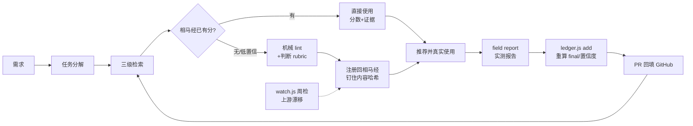

<div align="center">

# 🐴 伯乐 · Argus

### 会相马的 Skill 发现与评分器
**A skill that finds skills — and judges them by real quality, never by stars.**

*世有伯乐，然后有千里马。千里马常有，而伯乐不常有。* —— 韩愈《马说》

[](https://github.com/iifzx/bole/actions/workflows/ledger.yml)
[](https://github.com/iifzx/bole/blob/main/argus/data/index.json)
[](LICENSE)


[为什么](#-为什么做这个-why) · [三种模式](#-三种模式-three-modes) · [相马经](#-相马经-the-ledger) · [安装](#-安装-install) · [贡献](#-贡献-contribute)

</div>

---

## 🌗 为什么做这个 Why

我们对 Agent Skills 生态做了一轮调研，发现两个世界从不相交：

| 发现侧 | 评分侧 |
|---|---|
| skills.sh · SkillsMP · ClawHub | skillscore · 各类 linter |
| 能按需求搜 skill，但排序靠安装量和 star | 能打质量分，但只评你手动指定的 skill |
| **流行度 ≠ 质量，listing 无人审核** | **不会替你找，评完即蒸发** |

**Argus 把两个世界闭环，并让分数随真实使用持续成长。**

- 🐴 **伯乐**（中国）—— 相马师，识千里马于凡马之中：只看脚力，不看毛色。评分数据库因此叫《**相马经**》。
- 👁 **Argus**（希腊）—— 百眼巨人，一百只眼睛永不合眼：多源检索、看见一切。他死后眼睛化作孔雀尾羽上的眼斑——**每一次真实使用，都是一只新的眼睛在见证质量**。

## 🎯 三种模式 Three modes

| | 你说 | Argus 做 |
|---|---|---|
| 🔍 **FIND** | 「帮我找一个能处理 PDF 表格的 skill」 | 任务分解 → 相马经/`npx skills find`/网络 三级检索 → 逐个评分 → 双策略组合（每个子任务最优 vs 最少依赖） |
| ⚖️ **RATE** | 「这个 skill 质量怎么样？值不值得装？」 | 机械 lint（40 条规则）→ 人工判断 rubric → 触发评测 → 安全共识 → 千里马/良驹/驽马/病马判词 |
| 📮 **REPORT** | 「刚用完，报告一下效果」 | 实测报告 → `ledger.js add` 合并 → 重算分数与置信度 → 一个 PR 回填给全世界 |

## 📖 相马经 The Ledger

```
data/
├── index.json                    # 紧凑索引（agent 第一个读它，省 token）
├── skills/owner/repo/skill.json  # 完整记录：静态分 + 实测分 + final + 置信度 + 证据链
└── reports/...                   # append-only 实测报告（证据链）
```

**去 star 化的评分模型**（完整契约见 [`argus/references/scoring.md`](argus/references/scoring.md)）：

```
final = 0.4 × 静态分(5维rubric) + 0.6 × 实测分(三维)      # 真实效果权重更高
置信度 = 0.3 → 0.95，随独立实测报告增长；
        证据分歧 ×0.8 · 评分冲突 ×0.85 · 上游漂移 ×0.5 · 陈旧 ×0.9
star / 安装量 → 只进 popularity 元数据，永不进分数
```

**内容指纹防腐**：每次评分都把该 skill 的 SKILL.md 内容哈希（`content_hash`）钉进记录。`watch.js` 每周比对上游——**上游一改，置信度自动减半**，分数永远不替你没见过的内容背书。安全发现带 **severity 五级**（info→critical，借自 Cisco skill-scanner），high+ 才触发红线封顶 40 分。

**领域分类 + 生态数据**：每条记录带任务领域（12 类：文档处理 / 数据分析 / 浏览器自动化 / 测试 QA / 前端 UI / 后端 API / 云与运维 / 安全 / 写作内容 / 设计媒体 / 增长营销 / 元工具），由 [`scripts/taxonomy.js`](argus/scripts/taxonomy.js) 的机械分类器在导入时打标。榜单按领域分组展示；目录覆盖来自 SkillsMP 关键词搜索与 skills.sh 安装量排行——**借覆盖与元数据，永不借排名**（导入一律 pending 待评）。

**成长飞轮**：



## 🛡️ 相马经的战绩 Proven record

开账第一天（2026-11-18，18 条记录全部人工级评估）：

- **抓出 1 个逐字节复刻 fork**（magentosh 与 101-skills 的 agent-browser 哈希完全相同，已标 `duplicate_of`）
- **抓出 1 个伪造 MCP 能力声明**（xlsx-manipulation，10 个垃圾 frontmatter 键，60 分垫底）
- **抓到 1 次真实上游漂移**（wecomcli-sheet 上游当日改动，置信度已自动减半待重评）
- **修正了机械 lint 的 9 处误判**（中文启发式、引号内人称、代码块内密钥误报）——机械分只是基线，判断必须复核，这正是设计

📊 **[在线榜单](https://iifzx.github.io/bole/)** · [原始数据](argus/data/index.json)

## 🚀 安装 Install

前置：Node.js ≥ 18（所有脚本零依赖）。

```bash
# 方式一：skills CLI
npx skills add iifzx/bole

# 方式二：手动安装到任意支持 Agent Skills 的工具
git clone https://github.com/iifzx/bole
cp -r bole/argus ~/.agents/skills/argus     # ZCode / Claude Code / Codex 等通用
```

装完开新会话，直接说「**帮我找一个能做 X 的 skill**」即可触发。

<details>
<summary><b>🧰 全部 CLI 能力</b></summary>

```bash
node scripts/ledger.js validate-all          # 全量校验（schema + 派生字段一致性）
node scripts/ledger.js add <report.json>     # 实测报告入账（移动语义，自动重算）
node scripts/ledger.js static <patch.json>   # 注册静态评分（自动钉内容哈希 + 复刻检测）
node scripts/ledger.js mark-stale <id> <hash>  # 上游漂移 → 置信度减半
node scripts/ledger.js build-index [--check] # 索引重建 / CI 同步检查
node scripts/ledger.js show <id> / recompute
node scripts/lint.js check <path|--url>      # 机械 lint（40 条规则，输出建议 patch）
node scripts/lint.js eval init|run …         # 触发评测 harness（20 查询 → trigger_rate）
node scripts/lint.js conflicts               # 触发面重叠检测（防互相遮蔽）
node scripts/import.js skills-sh "kw" --top 5
node scripts/import.js skillsmp --creator n  # 外部目录批量导入（借覆盖不借排名）
node scripts/watch.js                        # 上游漂移周检
```
</details>

## 🤝 贡献 Contribute

最有价值的贡献不是代码，而是**实测报告**：装一个 skill、真实用一次、
[提交一份 field report](https://github.com/iifzx/bole/issues/new?template=field-report.yml)。
`failed` 和 `worked` 一样宝贵——它们正是把分数从「看起来不错」矫正成「真的好用」的力量。
完整流程见 [CONTRIBUTING.md](CONTRIBUTING.md)。

<details>
<summary><b>📦 项目结构</b></summary>

```
├── argus/                  # skill 本体（安装单元）
│   ├── SKILL.md            # 三模式工作流
│   ├── references/         # 评分公式 · rubric · 检索源（按需读取）
│   ├── scripts/            # ledger.js · lint.js · import.js · watch.js（全零依赖）
│   └── data/               # 相马经数据库（随 skill 分发）
├── docs/index.html         # GitHub Pages 在线榜单
├── CONTRIBUTING.md         # 回填实测报告的完整流程
└── .github/                # CI 校验 · 周检漂移 · issue 表单自动入账
```
</details>

<details>
<summary><b>🙏 致谢 Credits</b></summary>

Argus 站在这些轮子上（借用机制均已改造并注明出处）：

- [agentscope-ai/OpenJudge · find-skills-combo](https://github.com/agentscope-ai/OpenJudge/blob/main/skills/find-skills-combo/SKILL.md) —— 任务分解 + 候选矩阵机制；Argus 把它的「现场发挥」落地成持久化、可积累的证据账本
- [sayed3li97/skillscore](https://github.com/sayed3li97/skillscore) —— 27 规则×7 类别静态评分、token 预算、触发对齐 eval、触发面冲突检测 → 改造进 `lint.js`
- [joeynyc/skillscore](https://github.com/joeynyc/skillscore) —— 邻近秘密外泄检测、提权/无界循环检查、A+~F 等级表 → 改造进 `lint.js` 与展示层
- [cisco-ai-defense/skill-scanner](https://github.com/cisco-ai-defense/skill-scanner) —— severity 分级、LLM 共识评审、深扫推荐
- [vercel-labs/skills](https://github.com/vercel-labs/skills) —— 内容哈希/lockfile 思想 → 改造为评分防腐锚
- [SkillsMP](https://skillsmp.com) / [skills.sh](https://skills.sh) —— 免费目录 API 作导入原料源（只借覆盖，不借排名）
- [minedojo/voyager](https://github.com/minedojo/voyager) —— 自增长 skill library 思想源头
</details>

## License

[MIT](LICENSE)
