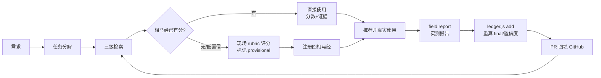

<div align="center">

# 伯乐 · Argus

**会相马的 Skill 发现与评分器 — a skill that finds skills, and judges them by
real quality, never by stars.**

*世有伯乐，然后有千里马。千里马常有，而伯乐不常有。* —— 韩愈《马说》

</div>

---

## 为什么做这个 / Why

We surveyed the Agent Skills ecosystem and found two worlds that never touch:

- **发现侧**（skills.sh、SkillsMP、ClawHub…）能按需求搜 skill，但排序靠
  安装量和 star —— 流行度不是质量，listing 完全开放无人审核；
- **评分侧**（skillscore、各类 linter）能打质量分，但只评你手动指定的
  skill，不会替你找。

**Argus 把两个世界闭环了，并且让分数随使用持续成长。**

- 🐴 **伯乐**（中国）：相马师，识千里马于凡马之中 —— 只看脚力，不看毛色。
  评分数据库因此叫《相马经》。
- 👁 **Argus**（希腊）：百眼巨人，一百只眼睛永不合眼，看见一切 —— 多源
  检索的寓意。他死后眼睛化作孔雀尾羽上的眼斑：**每一次真实使用，都是一只
  新的眼睛在见证质量**，评分因此持续成长。

## 三种模式 / Three modes

| 模式 | 你说 | Argus 做 |
|---|---|---|
| **FIND** | 「帮我找一个能处理 PDF 表格的 skill」 | 任务分解 → 相马经/`npx skills find`/网络 三级检索 → 逐个评分（结构·安全·实测）→ 双策略组合方案（每个子任务最优 vs 最少依赖） |
| **RATE** | 「这个 skill 质量怎么样？值不值得装？」 | 相马经查证 → 现场 rubric 评分（触发·结构·可执行性·安全·可移植）→ 红线安全扫描 → 千里马/良驹/驽马/病马判词 |
| **REPORT** | 「刚用完，报告一下效果」 | 生成实测报告 → `ledger.js add` 合并 → 重算分数与置信度 → 提示你一个 PR，把证据回填给全世界 |

## 相马经 / The Ledger

```
data/
├── index.json                    # 紧凑索引（agent 第一个读它，省 token）
├── skills/owner/repo/skill.json  # 完整记录：静态分 + 实测分 + final + 置信度 + 证据链
└── reports/...                   # append-only 实测报告（证据）
```

**去 star 化的评分模型**（详见 [`argus/references/scoring.md`](argus/references/scoring.md)）：

- `final = 0.4 × 静态分 + 0.6 × 实测分`（0–100）。**真实效果权重 0.6** —— 实测
  比静态文本分析更有发言权；
- star / 安装量只出现在 `popularity` 元数据里，**永远不进分数**；
- `confidence` 随独立实测报告数量增长（0.3 → 0.95 封顶），证据分歧、评分
  冲突、数据陈旧都会降低它 —— 低置信度的 skill 会被现场重验；
- 安全红线（prompt injection / 数据外泄 / 混淆与破坏性命令）直接封顶 40 分
  并强制警告，建议 [Cisco skill-scanner](https://github.com/cisco-ai-defense/skill-scanner) 深扫。

**成长飞轮**：



每装一次、用一次、报告一次，相马经对全世界的判断就更准一分。

## 安装 / Install

**前置**：Node.js ≥ 18（`ledger.js` 零依赖）。

```bash
# 方式一：skills CLI（仓库发布后）
npx skills add <your-username>/bole

# 方式二：手动安装到任意支持 Agent Skills 的工具
git clone https://github.com/<your-username>/bole
cp -r bole/argus ~/.agents/skills/argus     # ZCode / Claude Code / Codex 等通用
```

安装后开新会话，直接说「帮我找一个能做 X 的 skill」即可触发。

## 项目结构 / Layout

```
├── argus/                  # skill 本体（安装单元）
│   ├── SKILL.md            # 三模式工作流
│   ├── references/         # 评分公式 · rubric · 检索源（按需读取）
│   ├── scripts/
│   │   ├── ledger.js       # 相马经维护 CLI（零依赖）
│   │   ├── lint.js         # 机械预检引擎：~40 条规则，输出建议评分 patch
│   │   └── import.js       # 外部目录批量导入（SkillsMP / skills.sh → 待评估条目）
│   └── data/               # 相马经数据库（随 skill 分发）
├── CONTRIBUTING.md         # 如何回填实测报告
└── .github/workflows/      # CI：校验数据 + 索引同步检查
```

**借来的数据库，改造后使用**：`import.js` 从 SkillsMP（免费 REST API）和
skills.sh 批量拉取候选，只借**覆盖面**和**流行度元数据**，一条评分都不借
——所有导入条目落地为「待评估」（final 0 / 置信度 0），必须先过机械 lint +
人工判断 rubric 才有资格影响推荐。原则一句话：**借覆盖，不借排名**。

## 贡献 / Contribute

最有价值的贡献不是写代码，而是**实测报告**：装一个 skill、真实用一次、
提交一份 field report。`failed` 的报告和 `worked` 的一样宝贵 —— 它们正是
把分数从"看起来不错"矫正成"真的好用"的力量。流程见
[CONTRIBUTING.md](CONTRIBUTING.md)。

## 致谢 / Credits

Argus 站在这些轮子上（借用机制均已改造并注明出处）：

- [agentscope-ai/OpenJudge · find-skills-combo](https://github.com/agentscope-ai/OpenJudge/blob/main/skills/find-skills-combo/SKILL.md)
  —— 任务分解 + 候选矩阵机制的灵感来源；Argus 把它的"现场发挥"落地成
  持久化、可积累的证据账本；
- [sayed3li97/skillscore](https://github.com/sayed3li97/skillscore)
  —— 27 条规则 × 7 类别的静态评分设计、token 预算估算、触发面冲突检测，
  改造映射进 `lint.js` 与我们的 5 维 rubric；
- [joeynyc/skillscore](https://github.com/joeynyc/skillscore)
  —— 邻近秘密外泄检测（≤5 行）、提权/无界循环检查、可移植性规则、
  A+~F 等级表，同样改造进 `lint.js` 与展示层；
- [SkillsMP](https://skillsmp.com) / [skills.sh](https://skills.sh)
  —— 免费目录 API 作为导入原料源（只借覆盖，不借排名）；
- [cisco-ai-defense/skill-scanner](https://github.com/cisco-ai-defense/skill-scanner)
  —— 安全深扫推荐工具。

## License

[MIT](LICENSE)
